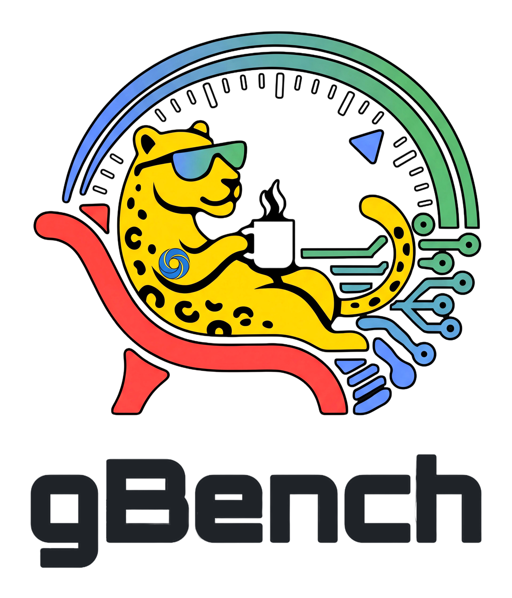

<p align="center">
  <picture>
    <source media="(prefers-color-scheme: dark)" srcset="docs/assets/gbench-logo.png">
    
  </picture>
</p>

# gBench: performance and capability benchmarks for open models

gBench is an open-source benchmarking and evaluation suite for open large language models (LLMs) and vision-language models (VLMs). It measures serving performance on the hardware it runs on, and model capability in three tiers: academic eval suites, the Golden Set smoke tests and the agentic quality suite.

It works with any OpenAI-compatible `/v1` server through `--remote-endpoint` (validated on vLLM and Ollama; on Cloud Run, a service that allows unauthenticated calls), or starts and stops a local vLLM server itself.

---

## Table of contents

- [Key features](#key-features)
- [Documentation](#documentation)
- [Installation](#installation)
- [Quick start](#quick-start)
- [Three capability evaluation tiers](#three-capability-evaluation-tiers)
- [Developer guide and contribution workflow](#developer-guide-and-contribution-workflow)
- [Authors](#authors)
- [License](#license)

---

## Key features

- OpenAI API compatibility: measure any OpenAI-compatible `/v1` endpoint with `--remote-endpoint <URL>/v1` (validated on vLLM and Ollama; on Cloud Run, a service that allows unauthenticated calls; see [Remote Endpoint Mode](docs/remote-endpoints.md#remote-endpoint-mode---remote-endpoint)).
- Three capability tiers:
  1. Academic and domain evals (`--evals`): 86 canonical Python suites in `--evals all` (plus `ui_control_osworld` and `swe_lancer`, which run only when named) across 6 core capability pillars (`General Knowledge & Scientific Reasoning`, `Mathematics & Proofs`, `Coding & Algorithmic Design`, `Long Context & Retrieval`, `Tool Use & Agentic Workflows`, `Multimodal Vision & Grounding`) with the model's reasoning mode on request (`--eval-thinking`), images sent as their original bytes where the dataset stores them (no re-encoding), plugin discovery (`--eval-plugins-dir`) and custom JSONL datasets (`--eval-custom-jsonl`).
  2. Golden Set smoke tests (`--golden-only`): 16 deterministic capability checks (`code_canonical`, `function_call_single`, `structured_json`, etc.) with two-sided presence assertions and `python_exec` unit-test matching, including a labelled [chat template subset](docs/golden-set.md#chat-template-sensitivity-pairs) that separates a broken chat template from a weak model.
  3. Agentic quality suite (`--quality-only`): the GemmaClaw / OpenClaw QA suite (the QA scenarios of the pinned GemmaClaw commit, 60 at d8bc6989; scenarios that need another model provider are listed apart and not scored) testing multi-turn tool calling, session memory and plugin routing, run in gBench's local `gbench-quality` Docker image (built once per GemmaClaw commit).
- Model discovery and GPU sizing: model properties read from the HuggingFace `config.json` (parameter count, MoE topology, vision/audio tokens), a recommended GPU tier per model size (1 GPU up to 20B, 2 GPUs up to 80B, 8 GPUs above) that is checked against the required `--num-gpus` (a warning when off the tier, a refusal when the model will not fit), and a server startup timeout that scales with model size (`max(600, min(3600, (300 + params_b * 10) * 3 * (1.3 if MoE)))`).
- Repeatability checks: several iterations per configuration with mean, median, standard deviation, P50, P95, P99 and the coefficient of variation, checked against `--max-cv-percent` (default 5.0).
- Open-loop stress sweep (`--stress-test`): one merged Poisson schedule per rate point at increasing rates (x2 per step) until a point fails; each of `--stress-reps` repeats gives a bracket [pass, fail], and the median repeat's limit is then certified with probes sized for the P99 SLO (a cohort of >= 1099 requests, about 1400 sent, the same rule on every device) to +-9% when that resolution is reached (otherwise a certified lower bound with its resolution, a lower bound censored at `--stress-max-qps`, or no limit when certification refutes the sweep), or reported UNCERTIFIED with the time certifying would need (`--stress-certify-budget`). A point passes when, on the requests planned after the point's ramp-up: the queue is not growing, >= 90% finish within the end-to-end time the SLOs imply, P99 TTFT and P99 ITL meet their SLOs, failures stay under 2% and the client kept to its schedule. The queue-growth test reads TTFT; overload that shows only as longer end-to-end times (for example KV-cache preemption) is left to the completion-fraction and ITL gates. SLOs are per campaign (5000 ms TTFT and 200 ms ITL without `--campaign`), overridden by `--stress-threshold` and `--itl-slo-ms`.

---

## Documentation

**Using gBench**

- [Installation](docs/installation.md): requirements, a virtual environment or conda, and the optional installs per use.
- [CLI argument reference](docs/cli-reference.md): every command-line flag.
- [Environment variables](docs/environment-variables.md), and every per-suite knob in [docs/evals/env-knobs.md](docs/evals/env-knobs.md).
- [Remote endpoint mode](docs/remote-endpoints.md): benchmarking any OpenAI-compatible `/v1` server, plus the preflight, smoke and parallel-suite modes ([docs/smoke.md](docs/smoke.md)).
- [Results](docs/results.md): output layout, result schemas, provenance and exit codes.
- [Distributed runs](docs/distributed-gbench.md): splitting a sweep across nodes (`--shard`) and merging the results (`--merge`).
- [Deployment modes](docs/deployment.md): the CLI today; container, Kubernetes and hosted modes on the roadmap.

**What gBench measures**

- [Performance benchmarks](docs/performance.md): model discovery, GPU tiers and selection, workload campaigns, dataset backends and repeatability.
- [Academic and custom eval suites](docs/eval-suites.md) (`--evals`), with one setup and scoring guide per suite in [docs/evals/](docs/evals/), plus [toolchains.md](docs/evals/toolchains.md) (optional dependencies), [docker-sandboxes.md](docs/evals/docker-sandboxes.md) (Docker address pools for the containerized suites) and [large-sweep-setup.md](docs/evals/large-sweep-setup.md) (host limits for long sweeps).
- [Golden Set capability smoke test](docs/golden-set.md) (`--golden-only`).
- [Agentic quality suite](docs/quality.md) (`--quality-only`).

**Background**

- [docs/THIRD_PARTY_DATASETS.md](docs/THIRD_PARTY_DATASETS.md): the datasets the suites load, with their licenses, gated and non-commercial terms. Each dataset's license governs your use of it and of the scores computed on it; read it before publishing results.
- [docs/RESOURCES.md](docs/RESOURCES.md): the upstream source of each suite. [docs/GOSPEL.md](docs/GOSPEL.md): what gBench is and who it is for.
- [Scaffold versioning](docs/scaffold-versioning.md): what each pillar pins, so results stay comparable. [Endpoint relay](docs/relay.md): how agent harnesses that cannot be pointed at the endpoint reach the served model. [Evals roadmap](docs/evals_roadmap.md): planned suites and the engineering playbook.
- [examples/notebooks/](examples/notebooks/): five runnable notebooks (Colab or local Jupyter, against Ollama or a vLLM endpoint; 05 needs Docker, so a local or cloud machine rather than Colab): [01 quickstart](examples/notebooks/01_gbench_101_quickstart.ipynb) (serving latency and the stress limit), [02 workload campaigns and concurrency](examples/notebooks/02_workloads_campaigns_and_concurrency.ipynb), [03 Golden Set smoke tests](examples/notebooks/03_golden_set_capability_smoke_tests.ipynb), [04 academic evals and reasoning mode](examples/notebooks/04_academic_evaluations_and_reasoning.ipynb) and [05 agentic quality with GemmaClaw](examples/notebooks/05_agentic_quality_with_gemmaclaw.ipynb).
- [CONTRIBUTING.md](CONTRIBUTING.md): how to contribute.

---

## Installation

```bash
git clone https://github.com/google-gemma/gbench.git
cd gbench
python3 -m venv venv && source venv/bin/activate

pip install -e .                 # base package (Python 3.11+): laptops and remote endpoints such as Ollama
# optional, per use:
pip install transformers         # --remote-endpoint: prompt sizing (--tokenizer), Golden Set chat-template
                                 # cases and the mmlu, wmdp, ruler and longbench_v2_code suites
pip install vllm                 # local GPU serving, and remote real-dataset workloads (--campaign chat-like,
                                 # --dataset custom/hf); gBench never installs vllm/torch itself
pip install -e ".[evals]"        # the eval suites' client, scorer and harness dependencies
```

The [installation guide](docs/installation.md) covers the requirements, conda, the optional installs per suite and the test environment.

---

## Quick start

```bash
# 1. Quick local performance smoke test (auto-starts local vLLM server)
gbench --models google/gemma-4-E4B-it --num-gpus 1 --preset quick

# 2. Run a specific workload performance campaign (e.g. agentic long-context)
gbench --models google/gemma-4-12B-it --num-gpus 1 --campaign agentic

# 3. Run the Golden Set capability smoke tests on a local vLLM server
#    gbench launches; its tool cases need the model's tool-call parser (Gemma 4 example)
gbench --golden-only --models google/gemma-4-12B-it --num-gpus 1 --tool-call-parser gemma4 --reasoning-parser gemma4

# 4. Run GemmaClaw agentic quality suite over remote endpoint
gbench --quality-only --models google/gemma-4-12B-it --remote-endpoint http://127.0.0.1:8000/v1 --tokenizer google/gemma-4-12B-it

# 5. Run academic evaluations with Chain-of-Thought reasoning against remote server
gbench --evals-only --remote-endpoint http://127.0.0.1:8000/v1 --tokenizer google/gemma-4-E4B-it --evals gpqa mmlu --eval-thinking --max-output-tokens 65536

# 6. Stage model artifacts from HuggingFace to Google Cloud Storage
gbench --models google/gemma-4-12B-it --stage-to-gcs gs://my-gbench-bucket/models/

# 7. Dry run: the plan, each server's vllm serve command, port, GPUs and base URL (validated)
gbench --models google/gemma-4-12B-it --num-gpus 1 --preset default --dry-run
```

---

## Three capability evaluation tiers

```
+-------------------------------------------------------------------------------+
|                         gbench capability evaluation                          |
+-------------------------------------------------------------------------------+
|  Tier 1: academic evals         |  Tier 2: Golden Set    |  Tier 3: agentic QA|
|  (--evals)                      |  (--golden-only)       |  (--quality-only)  |
|  - bfcl, gpqa, gsm8k, mmlu,     |  - 16 cases            |  - GemmaClaw suite |
|    mmmu_pro, mrcr, screenspot   |  - Two-sided presence  |  - QA scenarios    |
|  - Reasoning mode (--thinking)  |  - Chat template pairs |  - Multi-turn QA   |
|  - Vision soft-token budgets    |  - N/A-aware scoring   |  - Tools, memory   |
+---------------------------------+------------------------+--------------------+
                                         |
                                         v
+-------------------------------------------------------------------------------+
|                      OpenAI-compatible REST API (/v1)                         |
+-------------------------------------------------------------------------------+
|  Mode A: local vLLM server  <---- OR ---->  Mode B: remote endpoint           |
|  (Auto start / stop / VRAM poll)            (--remote-endpoint <URL>/v1)      |
+-------------------------------------------------------------------------------+
```

### Tier 1: academic and custom evals (`--evals`)

The full catalog of the 86 suites in 6 pillars, with each suite's protocol and options, custom plugins and JSONL suites: [docs/eval-suites.md](docs/eval-suites.md). Each suite has a setup and scoring guide in [docs/evals/](docs/evals/).

### Tier 2: Golden Set capability smoke test (`--golden-only`)

16 deterministic capability checks (code, math, tool calling, structured output, chat templates, factual knowledge, translation, safety, vision and audio) with two-sided presence assertions and `python_exec` unit-test matching, including a [chat-template subset](docs/golden-set.md#chat-template-sensitivity-pairs) that separates a broken chat template from a weak model. Details: [docs/golden-set.md](docs/golden-set.md).

### Tier 3: agentic quality suite (`--quality-only`)

Evaluates multi-turn agent behavior with the GemmaClaw / OpenClaw QA suite: the QA scenarios of the pinned GemmaClaw commit (60 at d8bc6989); scenarios that need a model provider other than the model under test and the Gemini API are listed apart and not scored.

- **Image build**: clones GemmaClaw (`~/.cache/gbench/gemmaclaw`, no working tree) and builds a local `gbench-quality` image from the commit's `git archive` (the TypeScript workspace installed and built inside it), then runs the suite in a container of that image against `/v1`.
- **Build cache**: the image is tagged with the commit and a digest of its Dockerfile, helpers and gBench's edits, so it is built once per commit (several minutes on the first run).
- **Configuration**: generates a throwaway `openclaw.json` that disables the third-party plugins the suite does not use, to keep memory use down.
- **Gemini-only helper models**: the QA suite's alternate model (`google/gemini-3.1-pro-preview`, via `--alt-model`, in place of `openai/gpt-5.4`), image-generation model (`google/gemini-3.1-flash-image-preview`, via a recorded edit applied in the image's build context, in place of `openai/gpt-image-1`) and memory embeddings (`google/gemini-embedding-001`, in place of `openai/text-embedding-3-small`) run on the Gemini API, and every Gemini call is recorded in `gemini_calls`; `GEMINI_API_KEYS` or `GEMINI_API_KEY` is required. No key reaches the model under test: the suite runs in gBench's own Docker container (no network, cloud metadata servers unreachable, a read-only checkout, a user without capabilities, no host path writable), and its only way out is a forwarder in the container that hands its model-endpoint and Gemini calls to a relay in gBench over a unix socket; the relay alone holds the keys and forwards only the Gemini API calls the suite makes. Harness errors (relay, endpoint, Gemini or container failures) are not scored; a model-endpoint 4xx other than 400 and 422 on the suite's own requests (for example the 404 of an endpoint that serves the model under another name) is one, and a run with no scenario left to score withholds its pass rate (`null`, printed `withheld`), never 0. Details: [docs/quality.md](docs/quality.md).

```bash
# Run specific GemmaClaw QA scenarios (by scenario id) from a local checkout
gbench --quality-only --remote-endpoint http://127.0.0.1:8000/v1 --tokenizer google/gemma-4-E4B-it --scenarios memory-recall mcp-plugin-tools-call --gemmaclaw-path /path/to/gemmaclaw
```

---

## Developer guide and contribution workflow

1. Install development environment (in a test environment, see tests/README.md): `pip install -e ".[dev,evals,omnidocbench]" transformers` and `python -m nltk.downloader punkt punkt_tab`; the system tools the tests exercise are bubblewrap, a Java runtime and Docker (the Unit Tests workflow installs exactly this)
2. Run code style check: `ruff check gbench/`
3. Run type checker: `mypy gbench/`
4. Run unit test suite: `pytest tests/` (the Gemma 4 chat-template artifact check is not a unit test; it lives in `tools/template_checks/`, see its README)
5. The pull-request gate is the unit-test suite (`pytest tests/`, see [CONTRIBUTING.md](CONTRIBUTING.md)). A change to the Golden Set keeps its two-sided presence assertions; the Golden Set itself measures a model and never gates a gBench merge.

---

## Authors

- [Luciano Martins](https://github.com/lucianommartins)
- [Frank Li](https://github.com/frankhli-rgb)

---

## License

Copyright 2026 Google LLC. Licensed under the Apache License, Version 2.0.
